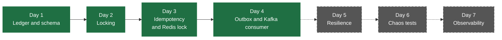
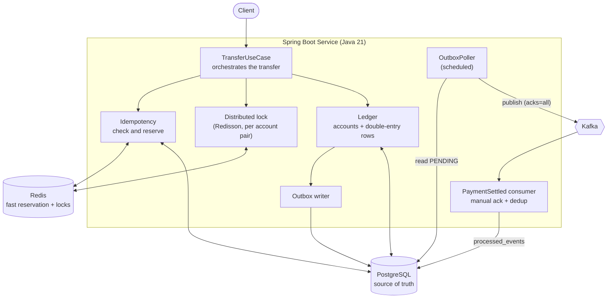
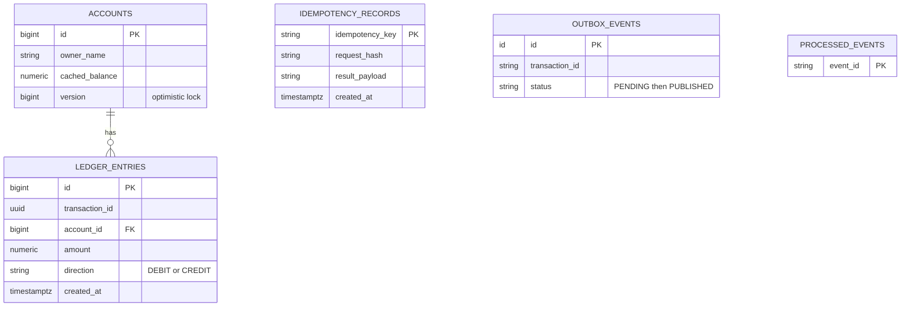

<div align="center">

# 💸 ResilientTransactions

### What `@Transactional` never told me.

*A payment ledger built to answer one question: what actually happens when many things try to change the same money at the same time, and something fails halfway through?*

<br>


</div>

---

## 📖 The Story

I was reading **Martin Kleppmann's *Designing Data-Intensive Applications***, and Chapter 7 stopped me.

Like most Spring developers, I had been writing `@Transactional` for years. I understood what it promised: **all or nothing**. Either every statement commits, or none of them do. For a long time that felt like the whole story.

Then the book asked questions that annotation had never made me ask:

- What does *isolation* actually mean, and what can still go wrong at the default level?
- If two requests read a balance of 100 and each subtract 30, why does the account end at 70?
- What happens when the same payment request is sent twice because the first response was lost?
- If my service crashes right after the database commit, what happens to the message I was about to send?
- Does a lock inside my application help at all once I run a second instance of it?

`@Transactional` answers none of these. It protects one transaction from *failing*. It does not protect a transaction from *other transactions*, and it says nothing about the world outside the database.

I didn't want to just read about it. I wanted to **reproduce the bugs, then fix them, and prove the fix with a test.** So I followed a structured build guide for a payment settlement engine, and built a small ledger where every one of those questions has a working answer.

> 💡 **The idea that tied it together:** not all work in a system needs the same kind of correctness.

| | **Must happen *now*, atomically** | **Must happen *eventually*, reliably** |
|---|---|---|
| **Example** | Moving ₹100 from Alice to Bob | "Payment confirmed" notification, audit trail, order confirmation |
| **If it fails** | Money is lost or created. Unacceptable. | Delayed is fine. **Lost** is not. |
| **Tool** | Database transaction, locking, versioning | Transactional outbox → Kafka → idempotent consumer |
| **Consistency** | Strong | Eventual |

The ledger entry belongs in the left column. The notification belongs in the right. Most of this project is about drawing that line carefully, and making sure nothing falls through it.

---

## 🧭 How Far I Got

The guide I followed was a seven-day plan. **I completed Days 1 to 4**, then ran out of time and stopped. I'd rather say that plainly than stretch it.



Green is built and tested. Grey is not built. Details are in [What I Deliberately Did Not Build](#-what-i-deliberately-did-not-build).

---

## 🏗️ Architecture

One Spring Boot service, built as a **modular monolith** with clean interface boundaries, so it could be split into microservices later without rewriting the business logic.



### One transfer, step by step

```mermaid
sequenceDiagram
    autonumber
    participant C as Client
    participant U as TransferUseCase
    participant I as Idempotency
    participant L as Redis lock
    participant DB as PostgreSQL
    participant P as OutboxPoller
    participant K as Kafka
    participant Q as Consumer

    C->>U: transfer(from, to, amount, idempotencyKey)
    U->>I: checkAndReserve(key)
    alt key already completed
        I-->>C: replay the original result
    else new request
        U->>L: lock accounts (fixed order)
        rect rgb(30, 80, 50)
        Note over U,DB: ONE database transaction
        U->>DB: update both balances (@Version check)
        U->>DB: insert DEBIT row + CREDIT row
        U->>DB: insert outbox event (PENDING)
        U->>DB: save idempotency record
        end
        U->>L: unlock
        U-->>C: transaction id
    end

    Note over P,Q: Later, asynchronously
    P->>DB: find PENDING events
    P->>K: publish event
    K-->>P: ack
    P->>DB: mark PUBLISHED
    K->>Q: deliver event
    Q->>DB: already in processed_events?
    Q->>DB: record processed event
    Q-->>K: acknowledge offset
```



The green box is the whole trick. The money movement and the "tell the world about it" record are written in **the same transaction**. They both happen or neither does. Kafka is touched only afterwards, from a separate poller, so a crash at the worst possible moment cannot lose the event.

---

## 🗄️ Data Model

Managed by **Flyway** (forward-only, versioned migrations).



- **Double-entry:** every transfer is a debit row and a credit row that sum to zero. Corruption becomes visible.
- **Append-only:** nothing in the codebase updates or deletes a ledger row.
- **`cached_balance`:** a fast read of the current balance. The ledger remains the record of what happened.
- **Money is `BigDecimal` / `NUMERIC(19,4)`, never `double`.**

---

## 🎯 The Seven Scenarios

The guide is built around seven failure scenarios, each of which should be **proven by a test, not just described.** This is where I stand on each.

| # | Scenario | Status | Proof |
|---|---|---|---|
| 1 | Many requests debit the same account at once: no lost update, no overdraft | ✅ Proven | `TransferUseCaseDay3Test2`, `TransferUseCaseConcurrencyTest` |
| 2 | A client retries the same payment: money moves exactly once | ✅ Proven | `TransferUseCaseDay3Test` |
| 3 | A consumer processes events and must not double-apply them | 🟡 Consumer and dedup table verified; crash-mid-batch kill test not automated | `Day4ConsumerTest` |
| 4 | Crash between DB commit and Kafka publish: event is not lost | ✅ Proven | `Day4OutboxTest`, `Day4OutboxBacklogTest` |
| 5 | Two service instances touch the same account: only a distributed lock helps | 🟡 Built with Redisson; verified by running two instances, not by an automated test | n/a |
| 6 | A slow downstream dependency: fail fast instead of piling up threads | ⬜ Not built (Day 5) | n/a |
| 7 | A burst of requests: reject the excess cleanly | ⬜ Not built (Day 5) | n/a |

### What each test actually proves

<details>
<summary><b>TransferUseCaseDay3Test</b>: 20 concurrent requests, same idempotency key</summary>

<br>

Twenty threads are released at the same instant, all sending the **identical** payment with the **same** idempotency key.

After they finish, the test asserts that:

- the source account went from `1000.00` to `900.00` and the destination from `0.00` to `100.00`. **One** transfer, not twenty.
- total money in the system is still exactly `1000.00`.
- exactly one idempotency record exists, and its stored result equals what the callers received.

</details>

<details>
<summary><b>TransferUseCaseDay3Test2</b>: 20 concurrent requests, different keys, not enough money</summary>

<br>

Alice has `1000.00`. Twenty threads each try to send `100.00` with their **own** idempotency key. Only ten can possibly succeed.

The test asserts that:

- **exactly 10** transfers succeed and **exactly 10** are rejected.
- Alice ends at exactly `0.00` (**no overdraft**) and Bob at exactly `1000.00`.
- total money is still `1000.00`.
- both accounts' `@Version` counters ended at exactly `10`, one increment per successful transfer.

This is the lost-update scenario from the book, turned into an assertion.

</details>

<details>
<summary><b>TransferUseCaseConcurrencyTest</b>: concurrency report with per-thread timing</summary>

<br>

Ten threads transfer between the same pair of accounts at once. The test records, for every thread, when it started, how long it took, and whether it succeeded, then prints a report with total wall-clock time, average, min and max duration, and the final balances and versions. I used it to *see* how threads queue up under contention.

</details>

<details>
<summary><b>Day4OutboxTest</b>: the outbox event survives and gets published</summary>

<br>

After a transfer completes, the test checks that a durable outbox event exists with status `PENDING`. It then runs the poller, as it would run after a restart, and asserts that the event is no longer among the unpublished events.

</details>

<details>
<summary><b>Day4OutboxBacklogTest</b>: draining a large backlog</summary>

<br>

A Flyway migration seeds a backlog of unpublished events. The test runs the poller once and measures how many events were discovered, published and remaining, plus total time, average per event and throughput. It asserts that nothing is left unpublished and that every discovered event was published.

</details>

<details>
<summary><b>Day4ConsumerTest</b>: the consumer records what it processes</summary>

<br>

Two events are sent through Kafka. The test waits up to 15 seconds and asserts that the consumer processed both and wrote a `processed_events` record for each. That table is what makes the consumer **idempotent**: a redelivered event is recognized and skipped.

</details>

---

## 🧠 Key Ideas I Can Now Explain

**Why a cached balance and a ledger?**
The ledger is the history, append-only and immutable. The cached balance is a fast projection of it. Keeping both means reads are cheap and corruption is detectable.

**Why `@Version` (optimistic locking)?**
Two transactions read the same balance and both write back. Without protection, one update silently disappears. A version column makes the second writer fail instead of overwriting, and the caller retries. It is cheap under low contention because nothing blocks.

**Why lock accounts in a fixed order?**
If one transfer locks A then B while another locks B then A, they deadlock. Always locking in ascending id order makes that impossible.

**Why does the idempotency record live in Postgres, not only Redis?**
Redis is fast but best-effort. Redis answers "is someone already working on this key?" quickly, but the durable record of what the result was must survive a restart. For money, Postgres is the source of truth.

**Why do you need a distributed lock at all?**
`synchronized` and `ReentrantLock` protect memory inside one JVM. Once there are two instances of the service, they don't see each other. A lock in Redis does.

**Why an outbox instead of just calling Kafka after the commit?**
Between the commit and the `send()` call, the process can die. The ledger is correct, but the event is gone forever, and nothing reports an error. Writing the event into the same transaction as the money movement turns "maybe lost" into "durably recorded, published when possible."

**What does exactly-once really mean here?**
It doesn't exist end to end. What I built is **at-least-once delivery plus an idempotent receiver**, which behaves like exactly-once. The outbox may publish an event twice; the consumer's dedup table makes that harmless.

---

## 🧰 Tech Stack

| Layer | Technology |
|---|---|
| Language / runtime | Java 21 |
| Framework | Spring Boot 4.1, Spring Data JPA, Spring Web MVC |
| Database | PostgreSQL, with Flyway migrations |
| Locking and idempotency | Redis, Redisson |
| Messaging | Apache Kafka 3.8 (Spring Kafka) |
| Testing | JUnit 5, AssertJ, `@SpringBootTest` integration tests |
| Resilience (added, not wired yet) | Resilience4j |

---

## 🚀 Running It

The tests are real integration tests: they need a running PostgreSQL, Redis and Kafka.

```bash
# PostgreSQL
docker run -d --name ledger-pg -p 5432:5432 \
  -e POSTGRES_DB=ledgerdb -e POSTGRES_PASSWORD=yourpassword postgres:16-alpine

# Redis
docker run -d --name ledger-redis -p 6379:6379 redis:7-alpine

# Kafka (single node, KRaft)
docker run -d --name ledger-kafka -p 9092:9092 apache/kafka:3.8.0
```

Point `application.properties` at them (datasource, Redis host and port, Kafka bootstrap servers), then:

```bash
./mvnw test                                 # everything
./mvnw test -Dtest=TransferUseCaseDay3Test  # one test
```

Flyway creates the schema on startup. The tests print readable reports (per-thread timings, final balances, versions, throughput) so you can follow what happened, not just see green.

---

## 🚫 What I Deliberately Did Not Build

I stopped after Day 4. The pieces below were part of the plan and are **not implemented**:

| Planned | Status |
|---|---|
| **Day 5:** circuit breaker, retry with backoff, bulkhead around a (simulated) fraud check | The Resilience4j dependency is in the `pom.xml`, but nothing is wired to it |
| **Day 5:** token-bucket rate limiting on the ingestion endpoint | Not built |
| **Day 6:** chaos tests: DB connection cut mid-transaction, client disconnects, virtual-thread pinning | Not built |
| **Day 7:** Micrometer metrics, Prometheus, Grafana dashboard | Not built |
| **Stretch:** real microservices, API gateway, OpenTelemetry tracing, Saga, Kubernetes | Out of scope |

That means scenarios 6 and 7 are open, and the system has **no protection against a slow dependency or a burst of traffic yet.** The ledger, idempotency and outbox core is solid. The resilience layer around it is next.

---

## 🗺️ What's Next

- [ ] Wire Resilience4j: circuit breaker, retry with jitter and bulkhead around a simulated fraud check
- [ ] Rate-limit the ingestion endpoint (HTTP 429, not a hang)
- [ ] Automate the consumer crash-and-restart scenario
- [ ] Automate the two-instance distributed lock proof
- [ ] Chaos suite with Testcontainers and Toxiproxy
- [ ] Micrometer metrics and one Grafana dashboard
- [ ] Split into services only after the monolith is fully proven

---

## 📚 What I Learned From

- **Martin Kleppmann**, *Designing Data-Intensive Applications*: Chapter 7 (Transactions) and Chapter 8 (The Trouble with Distributed Systems). This is where the whole project started.
- **Vlad Mihalcea**: his posts on optimistic and pessimistic locking in JPA.
- **Chris Richardson**, microservices.io: the *Transactional Outbox* pattern.
- **Stripe API docs**: *Idempotent Requests*, the reference design for the pattern.
- **PostgreSQL docs**: *Transaction Isolation* and *Explicit Locking*.

---

<div align="center">

**Built by Prashant** · because "all or nothing" was never the whole story

*The most useful thing a transaction taught me: the interesting failures happen between the lines.*

</div>
